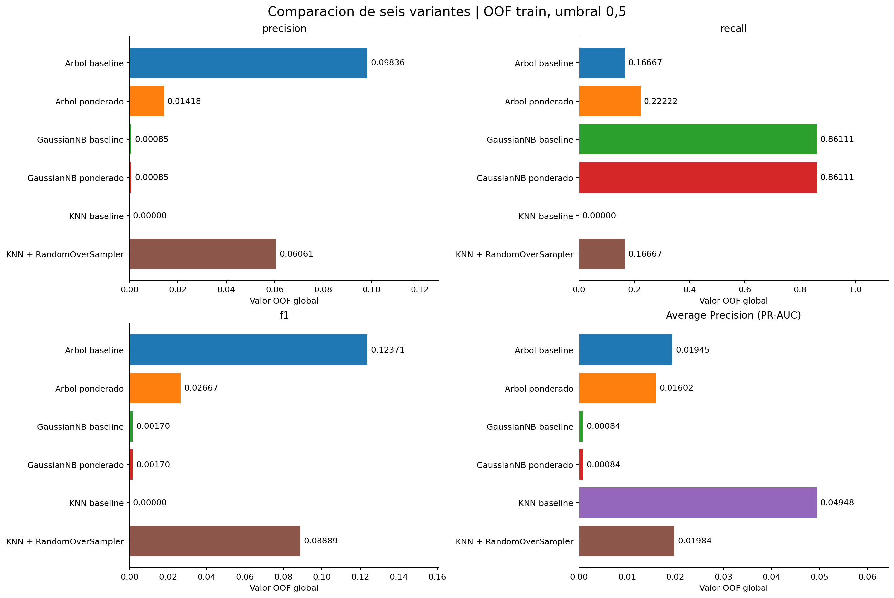
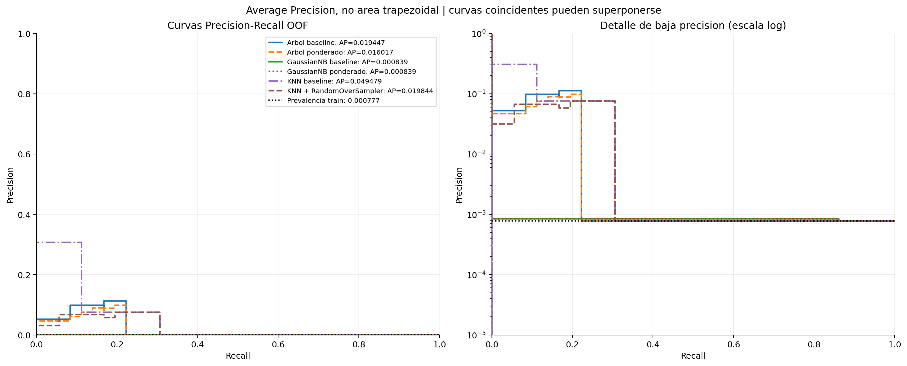

# Modelado supervisado de Fase 4: comparación out-of-fold

Fecha: 2026-11-18. Se completaron **seis variantes y cinco folds por variante**, con 277.830 predicciones OOF en total: exactamente una por cada uno de los 46.305 eventos para cada variante. No se utilizó test ni se entrenó un modelo final sobre todo train.

## Decisión ejecutiva

**No existe evidencia suficiente para elegir un ganador único que deba pasar ya a test.** Finalistas para investigación adicional: **Árbol de Decisión baseline** y **KNN baseline**. El árbol ofrece el mejor compromiso observado al umbral fijo de 0,5 entre detección, falsas alarmas, estabilidad y coste; KNN presenta la mejor Average Precision, pero ninguna detección correcta al umbral actual. El primero no se selecciona automáticamente por F1: ambos tienen limitaciones incompatibles con afirmar superioridad general.

No se ha cambiado el umbral para rescatar ningún resultado. La siguiente decisión necesita una tolerancia explícita de falsas alarmas y un objetivo de recall, más evidencia de estabilidad en usuarios positivos. Cualquier ajuste futuro debe hacerse dentro de train con validación agrupada adecuada, antes de congelar un candidato y solicitar la evaluación final en test.

## Fuentes y alcance

Se inspeccionaron los informes `INFORME_CORRECCION_TARGET_FASE03.md`, `INFORME_PARTICION_FASE04.md`, `INFORME_PREPROCESAMIENTO_FASE04.md` e `INFORME_REVISION_IMPOSSIBLE_TRAVEL_FASE04.md`, los módulos de `fase04_preparacion/`, el manifiesto y el inventario de artefactos existentes. No se reutilizaron matrices NPY ni preprocesadores ajustados con todo train.

La ejecución solo carga `dataset_train_fase04.csv`. Se conservaron los seis predictores aprobados: Device Type, Country, failed_attempts_15min, failed_attempts_1h, time_since_previous_login_hours y has_previous_login. User ID solo se usa para grupos y trazabilidad; timestamp e IP solo para identificar eventos; el target solo para aprendizaje/evaluación supervisada. No se reincorporaron variables excluidas ni se consultó el RBA.

SHA-256 train: `98d4d4970ada7bf11ec2e76f89e93c46c76c3d097043020598638547f977e53f`.
SHA-256 del origen corregido verificado solo para integridad: `7cdf551319fa3de9f8b5805a59ee07a83d7f51fc9dc3cebe8a3cc9d74aa584ab`.

## Protocolo fijado antes del entrenamiento

StratifiedGroupKFold con n_splits=5, shuffle=True, random_state=42, y binaria por evento y groups=User ID. Se usan exactamente los mismos folds en las seis variantes. Los 1.600 usuarios se mantienen enteros; cero intersecciones subtrain/validación. Los folds tienen ambas clases.

La estratificación es aproximada: la validación del fold 3 tiene solo un ATO. Se informó antes de entrenar y se mantuvo el protocolo solicitado. Una alternativa futura sería estratificar una tabla de usuarios por presencia de ATO, pero no se aplicó ni se buscaron semillas favorables.

| fold | usuarios_compartidos | subtrain_eventos | subtrain_usuarios | subtrain_positivos | subtrain_usuarios_positivos | validacion_eventos | validacion_usuarios | validacion_positivos | validacion_usuarios_positivos |
|---|---|---|---|---|---|---|---|---|---|
| 1 | 0 | 37490 | 1280 | 26 | 25 | 8815 | 320 | 10 | 9 |
| 2 | 0 | 37091 | 1280 | 28 | 26 | 9214 | 320 | 8 | 8 |
| 3 | 0 | 36770 | 1281 | 35 | 33 | 9535 | 319 | 1 | 1 |
| 4 | 0 | 36299 | 1280 | 28 | 26 | 10006 | 320 | 8 | 8 |
| 5 | 0 | 37570 | 1279 | 27 | 26 | 8735 | 321 | 9 | 8 |

La población de train tiene 36 positivos, 46.269 negativos y 34 usuarios con ATO. Prevalencia: 0,000777454 (0,0777454%). El AP de una puntuación constante sería esa prevalencia. No se utiliza accuracy como criterio.

## Transformaciones dentro de cada fold

Se crean nuevos ColumnTransformer/Pipeline con las fábricas aprobadas para cada variante y fold. Medianas y categorías se ajustan solo con subtrain; validación usa únicamente transform. OneHotEncoder(handle_unknown="ignore") para Device Type y Country. Las binarias y dummies permanecen en 0/1.

- Árbol: mediana numérica, sin escalado.
- GaussianNB: mediana y log1p de las tres magnitudes numéricas, sin escalado adicional.
- KNN: mediana, log1p y StandardScaler de esas tres magnitudes. No se estandarizan binarias/dummies.

Las entradas numéricas negativas o infinitas se rechazan antes de log1p. El intervalo ausente se distingue mediante has_previous_login. El número de columnas puede variar entre folds por categorías ausentes; sus nombres, medianas, categorías y filas de ajuste se registran para los treinta ajustes en `fase04_modelado/resultados/configuracion_auditoria.json`.

## Modelos y parámetros

Los parámetros fueron fijados sin búsqueda y se guardan completos en CSV/XLSX:

- Árbol baseline: criterion=gini, splitter=best, max_depth=None, min_samples_split=2, min_samples_leaf=1, ccp_alpha=0, random_state=42; sin pesos. Se acepta como baseline sin poda, con riesgo de sobreajuste.
- Árbol ponderado: idéntico, class_weight="balanced", frecuencias calculadas por el estimador solo sobre subtrain.
- GaussianNB baseline: priors=None, var_smoothing=1e-9.
- GaussianNB ponderado: mismo estimador; sample_weight por clase c = n_subtrain/(2*n_c_subtrain). No usa frecuencias de validación ni del conjunto completo.
- KNN baseline: n_neighbors=5, weights="uniform", metric="euclidean", algorithm="brute", n_jobs=2. p=2 y leaf_size=30 figuran en get_params; leaf_size no interviene en brute.
- KNN + RandomOverSampler: mismo KNN, ROS con sampling_strategy=1.0 y random_state=42, exclusivamente sobre subtrain transformado. Validación conserva todos sus eventos originales.

La importación de imbalanced-learn 0.14.2 y su smoke test fueron satisfactorios. Una primera impresión diagnóstica intentó consultar `.shape` de una lista y falló; se corrigió a `len`, sin alterar datos ni el experimento. No hubo fallo de compatibilidad ni instalación de paquetes.

Las seis variantes producen predict_proba. Se usa la columna correspondiente a classes_=1 y predicción positiva si score >= 0,5, incluidos empates. No se optimizaron umbrales ni se calibraron probabilidades. PR-AUC se informa como **Average Precision de sklearn**, no como integración trapezoidal. Precision/F1 indefinidos por ausencia de predicciones positivas se registran como 0 con bandera explícita por fold.

## Resultados OOF globales

Se calculan desde las predicciones concatenadas, no promediando las métricas de folds. Las tasas de esta tabla están en escala 0–1.

| nombre | TP | FP | TN | FN | precision | recall | f1 | average_precision |
|---|---|---|---|---|---|---|---|---|
| Arbol baseline | 6 | 55 | 46214 | 30 | 0.098361 | 0.166667 | 0.123711 | 0.019447 |
| Arbol ponderado | 8 | 556 | 45713 | 28 | 0.014184 | 0.222222 | 0.026667 | 0.016017 |
| GaussianNB baseline | 31 | 36476 | 9793 | 5 | 0.000849 | 0.861111 | 0.001697 | 0.000839 |
| GaussianNB ponderado | 31 | 36476 | 9793 | 5 | 0.000849 | 0.861111 | 0.001697 | 0.000839 |
| KNN baseline | 0 | 5 | 46264 | 36 | 0.000000 | 0.000000 | 0.000000 | 0.049479 |
| KNN + RandomOverSampler | 6 | 93 | 46176 | 30 | 0.060606 | 0.166667 | 0.088889 | 0.019844 |

## Media y desviación estándar entre folds

Medias no ponderadas; DE muestral (ddof=1). No son intervalos de confianza ni cinco experimentos independientes. La media puede diferir de la métrica OOF global; AP global además mezcla puntuaciones de estimadores ajustados en folds distintos, sin calibración común.

| nombre | precision_media_folds | precision_sd_folds | recall_media_folds | recall_sd_folds | f1_media_folds | f1_sd_folds | average_precision_media_folds | average_precision_sd_folds |
|---|---|---|---|---|---|---|---|---|
| Arbol baseline | 0.090894 | 0.061232 | 0.137222 | 0.095290 | 0.103204 | 0.062211 | 0.020020 | 0.013758 |
| Arbol ponderado | 0.065362 | 0.123376 | 0.187222 | 0.141607 | 0.062607 | 0.097436 | 0.028596 | 0.032270 |
| GaussianNB baseline | 0.000863 | 0.000428 | 0.893333 | 0.153478 | 0.001724 | 0.000854 | 0.000873 | 0.000428 |
| GaussianNB ponderado | 0.000863 | 0.000428 | 0.893333 | 0.153478 | 0.001724 | 0.000854 | 0.000873 | 0.000428 |
| KNN baseline | 0.000000 | 0.000000 | 0.000000 | 0.000000 | 0.000000 | 0.000000 | 0.073962 | 0.103755 |
| KNN + RandomOverSampler | 0.055929 | 0.072207 | 0.135000 | 0.138744 | 0.075829 | 0.090760 | 0.026823 | 0.038089 |

## Resultados individuales completos

| nombre | fold | TP | FP | TN | FN | precision | recall | f1 | average_precision | sin_predicciones_positivas |
|---|---|---|---|---|---|---|---|---|---|---|
| Arbol baseline | 1 | 2 | 17 | 8788 | 8 | 0.105263 | 0.200000 | 0.137931 | 0.017316 | False |
| Arbol baseline | 2 | 2 | 16 | 9190 | 6 | 0.111111 | 0.250000 | 0.153846 | 0.038089 | False |
| Arbol baseline | 3 | 0 | 4 | 9530 | 1 | 0.000000 | 0.000000 | 0.000000 | 0.000105 | False |
| Arbol baseline | 4 | 1 | 13 | 9985 | 7 | 0.071429 | 0.125000 | 0.090909 | 0.025153 | False |
| Arbol baseline | 5 | 1 | 5 | 8721 | 8 | 0.166667 | 0.111111 | 0.133333 | 0.019434 | False |
| Arbol ponderado | 1 | 2 | 5 | 8800 | 8 | 0.285714 | 0.200000 | 0.235294 | 0.084241 | False |
| Arbol ponderado | 2 | 3 | 158 | 9048 | 5 | 0.018634 | 0.375000 | 0.035503 | 0.020737 | False |
| Arbol ponderado | 3 | 0 | 135 | 9399 | 1 | 0.000000 | 0.000000 | 0.000000 | 0.000105 | False |
| Arbol ponderado | 4 | 2 | 141 | 9857 | 6 | 0.013986 | 0.250000 | 0.026490 | 0.021110 | False |
| Arbol ponderado | 5 | 1 | 117 | 8609 | 8 | 0.008475 | 0.111111 | 0.015748 | 0.016789 | False |
| GaussianNB baseline | 1 | 8 | 6939 | 1866 | 2 | 0.001152 | 0.800000 | 0.002300 | 0.001148 | False |
| GaussianNB baseline | 2 | 8 | 6934 | 2272 | 0 | 0.001152 | 1.000000 | 0.002302 | 0.001152 | False |
| GaussianNB baseline | 3 | 1 | 7821 | 1713 | 0 | 0.000128 | 1.000000 | 0.000256 | 0.000128 | False |
| GaussianNB baseline | 4 | 8 | 7854 | 2144 | 0 | 0.001018 | 1.000000 | 0.002033 | 0.001018 | False |
| GaussianNB baseline | 5 | 6 | 6928 | 1798 | 3 | 0.000865 | 0.666667 | 0.001728 | 0.000920 | False |
| GaussianNB ponderado | 1 | 8 | 6939 | 1866 | 2 | 0.001152 | 0.800000 | 0.002300 | 0.001148 | False |
| GaussianNB ponderado | 2 | 8 | 6934 | 2272 | 0 | 0.001152 | 1.000000 | 0.002302 | 0.001152 | False |
| GaussianNB ponderado | 3 | 1 | 7821 | 1713 | 0 | 0.000128 | 1.000000 | 0.000256 | 0.000128 | False |
| GaussianNB ponderado | 4 | 8 | 7854 | 2144 | 0 | 0.001018 | 1.000000 | 0.002033 | 0.001018 | False |
| GaussianNB ponderado | 5 | 6 | 6928 | 1798 | 3 | 0.000865 | 0.666667 | 0.001728 | 0.000920 | False |
| KNN baseline | 1 | 0 | 0 | 8805 | 10 | 0.000000 | 0.000000 | 0.000000 | 0.252291 | True |
| KNN baseline | 2 | 0 | 4 | 9202 | 8 | 0.000000 | 0.000000 | 0.000000 | 0.039179 | False |
| KNN baseline | 3 | 0 | 0 | 9534 | 1 | 0.000000 | 0.000000 | 0.000000 | 0.000105 | True |
| KNN baseline | 4 | 0 | 0 | 9998 | 8 | 0.000000 | 0.000000 | 0.000000 | 0.072028 | True |
| KNN baseline | 5 | 0 | 1 | 8725 | 9 | 0.000000 | 0.000000 | 0.000000 | 0.006207 | False |
| KNN + RandomOverSampler | 1 | 3 | 14 | 8791 | 7 | 0.176471 | 0.300000 | 0.222222 | 0.093704 | False |
| KNN + RandomOverSampler | 2 | 2 | 40 | 9166 | 6 | 0.047619 | 0.250000 | 0.080000 | 0.017219 | False |
| KNN + RandomOverSampler | 3 | 0 | 10 | 9524 | 1 | 0.000000 | 0.000000 | 0.000000 | 0.000105 | False |
| KNN + RandomOverSampler | 4 | 1 | 17 | 9981 | 7 | 0.055556 | 0.125000 | 0.076923 | 0.016881 | False |
| KNN + RandomOverSampler | 5 | 0 | 12 | 8714 | 9 | 0.000000 | 0.000000 | 0.000000 | 0.006207 | False |

## Comparación y selección razonada

| Criterio | Resultado | Interpretación |
|---|---|---|
| Mayor Recall | GaussianNB baseline y ponderado: 0,861111 | 31 ATO detectados; 36.476 FP, coste operativo enorme |
| Mayor Average Precision | KNN baseline: 0,049479 | Mejor ordenamiento observado, pero recall 0 con umbral 0,5 |
| Mayor Precision | Árbol baseline: 0,098361 | 6 TP entre 61 alertas; todavía unas nueve falsas alarmas por acierto |
| Mayor F1 | Árbol baseline: 0,123711 | No compensa que omita 30 de 36 ATO |
| Menor variabilidad de Recall/Precision/F1 | KNN baseline: DE=0 en las tres | Estabilidad degenerada: no acierta ningún positivo en ningún fold |
| Menor DE de AP | GaussianNB baseline y ponderado: 0,000428 | AP consistentemente muy bajo; baja DE no acredita utilidad |
| Mejor equilibrio observado a 0,5 | Árbol baseline | Mejor precisión/F1, menos FP que ROS al mismo recall y menor coste de predicción; detección insuficiente para proclamar ganador |

No existe un modelo universalmente más estable en todas las dimensiones. Entre las alternativas que detectan ATO sin alertar sobre la mayoría de negativos, el árbol baseline presenta menor DE de recall (0,095290) que el ponderado (0,141607) y KNN ROS (0,138744).

**Árbol baseline, finalista:** frente a KNN ROS obtiene el mismo total de seis TP y 30 FN, pero 55 frente a 93 FP, mayor precisión y menor variabilidad de recall. Su AP es ligeramente inferior (0,019447 frente a 0,019844), sin evidencia de significación de esa diferencia. La falta de poda y hojas pequeñas implica riesgo de sobreajuste. Sigue omitiendo el 83,33% de positivos.

**KNN baseline, finalista de investigación:** su AP es la mayor y unas 2,54 veces la del árbol baseline, pero no detecta ningún ATO al umbral prefijado. La AP por fold varía de 0,000105 a 0,252291 (DE 0,103755), lo que impide describirlo como ganador estable. Sus puntuaciones son discretas por K=5; no se ensayaron nuevos K ni umbrales. Es un candidato para investigar ranking/regla de decisión exclusivamente dentro de train, no un modelo listo para test con la configuración actual.

**Árbol ponderado:** recupera dos ATO adicionales respecto al baseline a cambio de 501 falsas alarmas adicionales, menor AP y mayor variabilidad. Se descarta como candidato principal en esta primera comparación, sin afirmar que cualquier árbol ponderado futuro deba fallar.

**GaussianNB, ambas variantes:** las probabilidades OOF son exactamente iguales en esta ejecución (diferencia máxima 0), con 36.507 valores 1 y 9.798 valores 0. Los pesos sí se aplicaron y sus valores constan en la auditoría. La saturación observada es compatible con la mala adecuación gaussiana de dummies/variables casi constantes y varianzas pequeñas; es una explicación a investigar, no una causa demostrada en esta corrida. El recall alto proviene de alertar sobre cerca del 79% de todos los eventos, con precisión de solo 0,0849%. AP=0,000839 queda cerca de la prevalencia. No se ocultan ni se recomputan puntuaciones alternativas para mejorar su apariencia.

**KNN ROS:** el sobremuestreo permite seis TP al umbral actual, pero empeora AP respecto a KNN baseline y añade 88 FP. Frente al árbol baseline no mejora recall y exige más falsas alarmas y tiempo de predicción. Repetir los pocos ATO no añade ataques independientes y puede reforzar vecindarios de duplicados.

**Conclusión:** finalistas árbol baseline y KNN baseline; no se congela un ganador ni se autoriza implícitamente test. Si se exige priorizar una línea de trabajo inmediata, investigar el árbol baseline como referencia de decisión y contrastarlo con KNN como ranking, definiendo primero el coste aceptable de FP/FN. No se ha encontrado una variante que combine recall alto con falsas alarmas controladas.

## Tiempo y recursos

Antes de ejecutar se observaron 32.630.500 KiB de RAM total y 8.006.504 KiB libres (aprox. 7,64 GiB). Sin materializar distancias completas: para un fold de unos 37.000 subtrain y 9.000 validación, una matriz densa de distancias requeriría unos 2,5 GiB; con ROS aproximadamente el doble. Una matriz de características de 74.000 x 62 float64 ronda 35 MiB. Se limitaron hilos a dos, working_memory a 256 MiB y predict_proba a lotes de 512; el límite de trabajo de sklearn no es un límite duro del proceso.

Se conservaron todos los eventos, sin muestreo para acelerar. Los tiempos son suma de cinco folds, en segundos, de esta máquina y ejecución. Fit de KNN principalmente almacena observaciones; su coste está en predecir. No incluyen generación de figuras/XLSX. Preprocesamiento y remuestreo se separan de entrenamiento/predicción.

| nombre | preprocesamiento_s | sobremuestreo_s | entrenamiento_s | prediccion_s |
|---|---|---|---|---|
| Arbol baseline | 0.271520 | 0.000004 | 0.700980 | 0.011217 |
| Arbol ponderado | 0.252802 | 0.000005 | 0.290272 | 0.008457 |
| GaussianNB baseline | 0.269906 | 0.000004 | 0.095544 | 0.035684 |
| GaussianNB ponderado | 0.269967 | 0.000004 | 0.149444 | 0.028125 |
| KNN baseline | 0.282636 | 0.000004 | 0.024640 | 5.910446 |
| KNN + RandomOverSampler | 0.272424 | 0.259952 | 0.030604 | 8.644942 |

Tiempo total del bucle con auditorías y exportación de resultados: 19.761 s. RSS máximo observado al cierre de folds: 263.06 MiB. Es una medición puntual, no el pico continuo. Pequeños tiempos de sobremuestreo en variantes sin ROS son solo overhead del temporizador, no remuestreo efectivo.

## Controles metodológicos y pruebas

`python -B -m pytest -p no:cacheprovider -q fase04_modelado/tests`

Resultado: **12 pruebas aprobadas**, sin fallos, warnings ni skips en la corrida final. Se verificaron:

- Grupos disjuntos, cobertura completa, ambas clases y reproducción de folds con semilla 42.
- Exclusión de target/ID/variables no aprobadas, rechazo de magnitudes inválidas.
- Medianas y categorías contra el subtrain; media, varianza y número de observaciones de StandardScaler contra cálculos independientes del subtrain.
- Transformar una validación con categorías nuevas y valores extremos no altera el preprocesador.
- Huellas del preprocesador antes/después de transformar validación.
- ROS: cada fila re-muestreada procede de un índice de subtrain; etiqueta conservada. Huella de validación intacta.
- Correspondencia por evento_id y clave natural con train; exactamente una predicción OOF por evento y variante. evento_id es la posición base cero del CSV de train cuyo hash queda registrado; no se usa como predictor.
- Relectura de los 277.830 registros OOF, recomputación de métricas globales y por fold, medias/DE, y coincidencia numérica de la tabla XLSX con CSV.

No se reutilizó ni se ejecutó la suite de preparación que lee test. No se leyó el CSV de test ni sus matrices para modelar, graficar o comprobar resultados. La preservación de esos archivos se comprueba por tamaño/mtime, sin abrir su contenido; otros archivos protegidos se contrastan por SHA-256. La trazabilidad del experimento demuestra controles concretos, no ausencia universal de cualquier riesgo de procedencia de datos.

## Archivos y visualizaciones

Rutas relativas a la raíz:

- `fase04_modelado/resultados/comparacion_modelos.csv`: seis resultados OOF globales, medias/DE, tiempos y parámetros.
- `fase04_modelado/resultados/metricas_por_fold.csv`: treinta resultados individuales con tiempos y parámetros.
- `fase04_modelado/resultados/comparacion_modelos.xlsx`: hojas Comparacion, Por fold, Distribucion y Parametros; cifras numéricas verificadas. Tablas estáticas reproducibles, no simulador interactivo.
- `fase04_modelado/resultados/predicciones_oof.csv`: clave, evento_id, fold, variante, etiqueta real, probabilidad y predicción; User ID conservado como entero, no convertirlo a float.
- `fase04_modelado/resultados/distribucion_folds.csv`: eventos y usuarios por clase en subtrain/validación.
- `fase04_modelado/resultados/configuracion_auditoria.json`: versiones, recursos y treinta auditorías de ajuste.
- `fase04_modelado/resultados/tablas_exportacion.json`: entrada reproducible del exportador XLSX.

Cada gráfica existe en PNG y SVG. Todas proceden de OOF train, nunca de test:

| Ruta bajo fase04_modelado/resultados/graficas/ | Contenido |
|---|---|
| comparacion_metricas.png / .svg | Precision, Recall, F1 y AP globales, seis variantes con valores |
| curvas_precision_recall.png / .svg | Curvas PR y AP, vista completa y detalle con precision logarítmica; referencia de prevalencia |
| estabilidad_folds.png / .svg | Cuatro métricas en cada fold; se identifican las seis variantes |
| variabilidad_folds.png / .svg | Valores de folds y media +/- DE; no son intervalos de confianza, las barras pueden extenderse fuera de [0,1] |
| falsos_positivos_negativos.png / .svg | FP/FN absolutos por variante |
| confusion_arbol_baseline.png / .svg | Matriz de confusión árbol baseline |
| confusion_arbol_ponderado.png / .svg | Matriz de confusión árbol ponderado |
| confusion_gnb_baseline.png / .svg | Matriz de confusión GaussianNB baseline |
| confusion_gnb_ponderado.png / .svg | Matriz de confusión GaussianNB ponderado |
| confusion_knn_baseline.png / .svg | Matriz de confusión KNN baseline |
| confusion_knn_ros.png / .svg | Matriz de confusión KNN ROS |

Las curvas GaussianNB coinciden exactamente: ambas se incluyen en la leyenda con estilos distintos, pero se superponen. No se ha eliminado ninguna variante desfavorable. Se revisaron visualmente las figuras comparativas, estabilidad, variabilidad, FP/FN, una matriz individual y las cuatro vistas del XLSX. Las otras matrices usan la misma plantilla y sus conteos se verifican desde OOF.





## Código nuevo y reproducción

`fase04_modelado/`: folds.py (partición interna), modelos.py (clasificadores), auditoria.py (invariantes), metricas.py (conteos/tasas), entrenamiento.py (orquestación), visualizaciones.py, exportar_xlsx.mjs, informe.py y tests/. Se reutilizan solo las fábricas sin ajustar de fase04_preparacion; no se modifica código histórico. Las funciones separan responsabilidades sin introducir jerarquías artificiales.

Comandos desde la raíz, en una copia con destino de resultados inexistente:

```text
python -B -m fase04_modelado.entrenamiento
python -B -m fase04_modelado.visualizaciones
python -B -m pytest -p no:cacheprovider -q fase04_modelado/tests
```

El test XLSX requiere exportar primero `exportar_xlsx.mjs` con el Node del runtime y @oai/artifact-tool. El exportador resuelve la dependencia mediante una junction temporal `fase04_xlsx_deps_20261118/node_modules` a las dependencias ya instaladas del runtime; no modifica dependencias ni instala paquetes. `informe.py` crea exclusivamente un informe nuevo. Los destinos existentes se rechazan; no volver a ejecutar los generadores sobre esta entrega.

Versiones efectivas: {"python": "3.12.7", "sklearn": "1.7.2", "numpy": "2.3.4", "pandas": "2.3.3", "imblearn": "0.14.2"}. Semilla 42 en folds, árboles y ROS. La reproducibilidad exige además el mismo orden de filas y versiones; los tiempos no son deterministas. No se guardó un estimador final listo para test: solo resultados de la comparación.

## Limitaciones y siguiente etapa

36 ATO de 34 usuarios es una base muy pequeña; un acierto adicional cambia el recall OOF 2,78 puntos porcentuales. El fold 3 contiene uno solo. La variabilidad entre folds confunde diferencias de composición con variación del estimador y los subtrain se solapan. No se efectuaron contrastes de significación ni se interpretaron medias +/- DE como intervalos.

El dataset y la geografía son sintéticos, la muestra está enriquecida y la partición por usuario no es una validación temporal. Historial previo de cada usuario de validación se supone disponible secuencialmente como en la preparación aprobada. Las seis variables pueden ser insuficientes para esta tarea; no se ampliaron mirando resultados de test.

Ponderación/ROS alteran el aprendizaje y las probabilidades no están calibradas. GaussianNB sobre dummies no garantiza distribuciones gaussianas ni independencia. KNN sufre desbalance y posibles empates de vecinos con duplicados; el árbol sin poda puede memorizar patrones. No se puede inferir superioridad definitiva de una sola partición CV ni extrapolar prevalencia a producción.

Pendientes, sujetos a aprobación: definir coste FP/FN y recall mínimo, investigar estabilidad por usuarios positivos y un protocolo agrupado mejor equilibrado, estudiar calibración/umbrales y una búsqueda limitada dentro de train con evaluación anidada o separación interna. No elegir umbral y estimar su mejora con las mismas OOF sin reconocer sesgo de selección. Tras elegir y congelar una configuración, evaluar test una sola vez con autorización.

No se ejecutaron operaciones Git, cambios de rama, clustering ni instalaciones. Se preservaron datasets, módulos de Fase 3, preparación y artefactos previos. Esta etapa concluye con la comparación OOF, sin ganador forzado y con test reservado.
