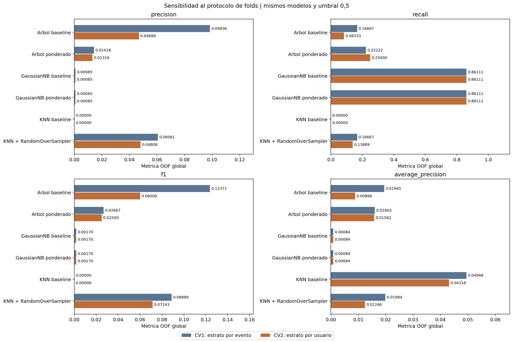
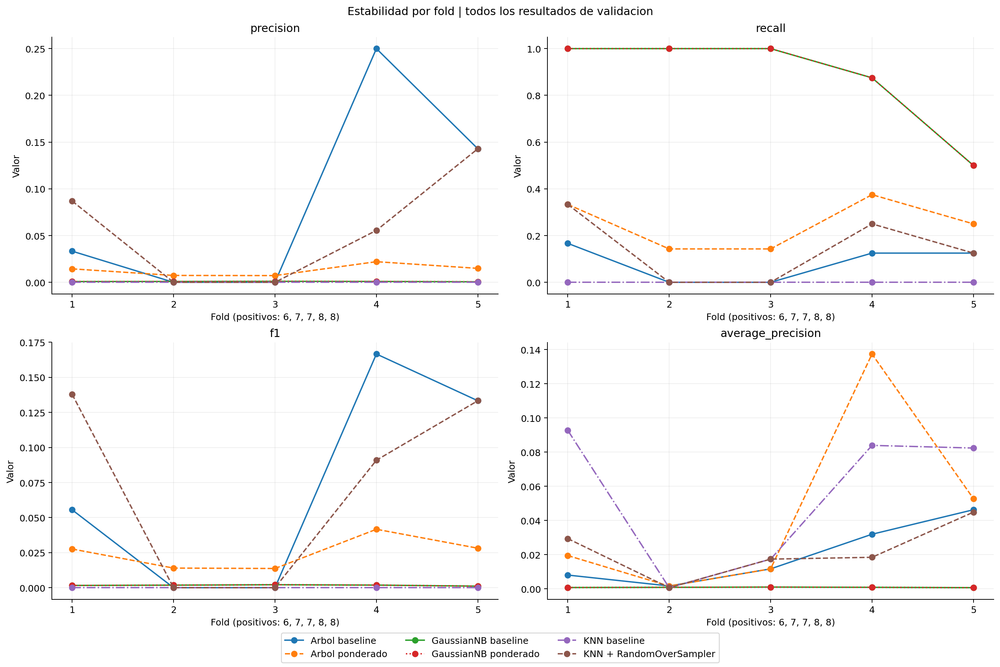

# Segunda validación cruzada de Fase 4: estratificación por usuario

Fecha: 2026-11-18. Análisis de sensibilidad de los mismos seis modelos, con todos los eventos de train. **No se declara ganador definitivo, no se entrena un modelo final y test permanece reservado.**

## Resumen y conclusión

Se completaron cinco folds para cada una de las seis variantes: treinta ajustes y 277.830 predicciones OOF (46.305 por variante). La nueva partición distribuye usuarios positivos como **6, 7, 7, 7, 7** y eventos ATO como **6, 7, 7, 8, 8**. Ya no existe el fold con un único positivo de la primera validación.

Las conclusiones anteriores se mantienen **parcialmente**. KNN baseline conserva la mayor AP, pero sigue sin detectar ATO al umbral 0,5. GaussianNB conserva recall alto con una carga de falsas alarmas inaceptablemente elevada para considerarlo ganador sin más. La preferencia anterior por el árbol baseline como mejor compromiso a 0,5 **no es robusta**: ahora pierde la mitad de sus aciertos, y KNN con ROS lo supera en precisión, recall, F1 y AP, aunque genera más falsas alarmas y cuesta más predecir.

Esto revela sensibilidad a la distribución de usuarios. **Cambia el protocolo de folds, no el algoritmo ni sus parámetros**; no son mejoras ni deterioros atribuibles a una nueva configuración del modelo. Ninguna variante logra simultáneamente detección alta, falsas alarmas controladas y evidencia suficiente de estabilidad. No se elige el protocolo por producir resultados más favorables.

## 1. Fuente y protección

Único dataset leído para construir folds, entrenar y validar: `dataset_train_fase04.csv`, 46.305 eventos, 1.600 usuarios, 36 ATO de 34 usuarios. SHA-256:

`98d4d4970ada7bf11ec2e76f89e93c46c76c3d097043020598638547f977e53f`

Se consultaron en solo lectura los CSV de resultados históricos, sus configuraciones y el código de modelado/preparación. No se cargaron test ni sus matrices, ni se reutilizaron transformadores ajustados con todo train. Los archivos existentes se preservan. Se comprueban hashes para archivos no test y tamaño/mtime para archivos de datos de test, sin abrir su contenido. No hubo operaciones Git, cambios de rama ni instalaciones.

Resultados nuevos: `fase04_modelado/resultados_cv_usuario/`. La primera ejecución permanece en `fase04_modelado/resultados/` sin modificaciones.

## 2. Protocolo exacto

1. Construir una fila por usuario con `usuario_con_ato=max(Is Account Takeover)`, ordenando User ID de forma ascendente (`groupby(sort=True)`).
2. Aplicar `StratifiedKFold(n_splits=5, shuffle=True, random_state=42)` a esa tabla, usando usuario_con_ato como estrato.
3. Expandir los identificadores de cada fold a todos sus eventos. Conservar el orden original de las filas de train al entrenar y predecir.
4. Verificar usuarios disjuntos, cobertura exacta de usuarios/eventos y ambas clases en subtrain/validación.

Se usó una sola semilla, 42, sin buscar alternativas favorables. Cada validación tiene 320 usuarios y cada subtrain 1.280. Estratificar usuarios no garantiza el mismo número de eventos: dos usuarios tienen dos ATO cada uno; las historias también difieren en tamaño. Se conserva esa desigualdad, sin eliminar ni redistribuir eventos.

### Composición de validaciones: ambos protocolos

Los números de fold solo identifican particiones internas; fold 1 de CV1 y fold 1 de CV2 no contienen necesariamente los mismos usuarios.

| protocolo | fold | validacion_usuarios | validacion_usuarios_positivos | validacion_usuarios_negativos | validacion_eventos | validacion_positivos | validacion_negativos |
|---|---|---|---|---|---|---|---|
| cv_evento | 1 | 320 | 9 | 311 | 8815 | 10 | 8805 |
| cv_evento | 2 | 320 | 8 | 312 | 9214 | 8 | 9206 |
| cv_evento | 3 | 319 | 1 | 318 | 9535 | 1 | 9534 |
| cv_evento | 4 | 320 | 8 | 312 | 10006 | 8 | 9998 |
| cv_evento | 5 | 321 | 8 | 313 | 8735 | 9 | 8726 |
| cv_usuario | 1 | 320 | 6 | 314 | 9235 | 6 | 9229 |
| cv_usuario | 2 | 320 | 7 | 313 | 10112 | 7 | 10105 |
| cv_usuario | 3 | 320 | 7 | 313 | 8321 | 7 | 8314 |
| cv_usuario | 4 | 320 | 7 | 313 | 9677 | 8 | 9669 |
| cv_usuario | 5 | 320 | 7 | 313 | 8960 | 8 | 8952 |

### Composición de subtrain de la segunda validación

| fold | subtrain_usuarios | subtrain_usuarios_positivos | subtrain_usuarios_negativos | subtrain_eventos | subtrain_positivos | subtrain_negativos | usuarios_compartidos |
|---|---|---|---|---|---|---|---|
| 1 | 1280 | 28 | 1252 | 37070 | 30 | 37040 | 0 |
| 2 | 1280 | 27 | 1253 | 36193 | 29 | 36164 | 0 |
| 3 | 1280 | 27 | 1253 | 37984 | 29 | 37955 | 0 |
| 4 | 1280 | 27 | 1253 | 36628 | 28 | 36600 | 0 |
| 5 | 1280 | 27 | 1253 | 37345 | 28 | 37317 | 0 |

La primera validación usa StratifiedGroupKFold con estratificación por evento y agrupación por usuario; distribuye usuarios positivos como 9, 8, 1, 8, 8 y eventos positivos como 10, 8, 1, 8, 9. La segunda controla directamente el equilibrio de usuarios con ATO. Ambas evitan usuarios compartidos, pero responden a distintas unidades de estratificación.

## 3. Modelos, transformaciones y reglas conservadas

Se reutiliza la fábrica histórica de clasificadores sin modificarla:

- Árbol baseline: gini, splitter=best, max_depth=None, min_samples_split=2, min_samples_leaf=1, ccp_alpha=0, random_state=42, sin ponderación.
- Árbol ponderado: misma configuración, class_weight="balanced" calculado sobre subtrain.
- GaussianNB baseline: priors=None, var_smoothing=1e-9.
- GaussianNB ponderado: igual, con sample_weight=n_subtrain/(2*n_clase_subtrain).
- KNN baseline: K=5, weights="uniform", métrica euclídea, algorithm="brute", n_jobs=2.
- KNN ROS: mismo KNN, RandomOverSampler(random_state=42, sampling_strategy=1.0) solo en subtrain transformado.

**Umbral positivo score >= 0,5** en todas las variantes; se mantiene la misma regla de empates. Los parámetros completos se registran en `metricas_por_fold.csv` y `comparacion_modelos.csv`; las pruebas los comparan con la primera ejecución.

Se mantienen exclusivamente Device Type, Country, failed_attempts_15min, failed_attempts_1h, time_since_previous_login_hours y has_previous_login. User ID solo agrupa y traza; timestamp/IP solo identifican el evento; target está fuera de X. Impossible Travel y las demás exclusiones se mantienen.

Cada fold y variante recibe un preprocesador nuevo: medianas y OneHotEncoder(handle_unknown="ignore") ajustados solo con subtrain. Árbol sin escalado; GaussianNB con log1p en las tres numéricas; KNN con log1p y StandardScaler numérico. Binarias y dummies no se estandarizan. log1p es determinista y no aprende parámetros; se vuelve a aplicar dentro del flujo del fold. Se bloquean valores numéricos negativos/no finitos.

La ponderación usa exclusivamente subtrain. ROS ocurre después de ajustar el preprocesador, antes del KNN, sin alterar validación. No se reutilizan NPY ni preprocesadores entrenados con todo train. Cada artefacto de auditoría registra las categorías efectivamente aprendidas, por lo que no se exige artificialmente un número idéntico de columnas entre folds.

El nuevo motor se obtuvo conservando exactamente el código de ejecución anterior salvo la importación del constructor de folds y el destino de salida. Una prueba compara ambos textos normalizados: no se modificaron hiperparámetros, remuestreo, transformaciones, hilos ni lotes para favorecer esta corrida. Esta duplicación acotada permite preservar la implementación histórica sin refactorizarla.

## 4. Métricas OOF globales de la segunda validación

Tasas en escala 0–1. Conteos acumulados sobre predicciones OOF, no sobre entrenamiento. Average Precision (AP) se calcula con average_precision_score, no con área trapezoidal ni accuracy.

| nombre | TP | FP | TN | FN | precision | recall | f1 | average_precision |
|---|---|---|---|---|---|---|---|---|
| Arbol baseline | 3 | 61 | 46208 | 33 | 0.046875 | 0.083333 | 0.060000 | 0.008862 |
| Arbol ponderado | 9 | 675 | 45594 | 27 | 0.013158 | 0.250000 | 0.025000 | 0.015817 |
| GaussianNB baseline | 31 | 36447 | 9822 | 5 | 0.000850 | 0.861111 | 0.001698 | 0.000840 |
| GaussianNB ponderado | 31 | 36447 | 9822 | 5 | 0.000850 | 0.861111 | 0.001698 | 0.000840 |
| KNN baseline | 0 | 1 | 46268 | 36 | 0.000000 | 0.000000 | 0.000000 | 0.043163 |
| KNN + RandomOverSampler | 5 | 99 | 46170 | 31 | 0.048077 | 0.138889 | 0.071429 | 0.012462 |

**La AP global concatena puntuaciones de cinco estimadores distintos. Su escala puede no ser comparable entre folds**, especialmente con distintas frecuencias, categorías y ponderaciones. Se informa junto a AP por fold; no se supone calibración común ni se equipara el promedio de AP con la AP OOF global.

## 5. Resultados individuales por fold

| nombre | fold | TP | FP | TN | FN | precision | recall | f1 | average_precision | sin_predicciones_positivas |
|---|---|---|---|---|---|---|---|---|---|---|
| Arbol baseline | 1 | 1 | 29 | 9200 | 5 | 0.033333 | 0.166667 | 0.055556 | 0.008085 | False |
| Arbol baseline | 2 | 0 | 12 | 10093 | 7 | 0.000000 | 0.000000 | 0.000000 | 0.001701 | False |
| Arbol baseline | 3 | 0 | 11 | 8303 | 7 | 0.000000 | 0.000000 | 0.000000 | 0.011710 | False |
| Arbol baseline | 4 | 1 | 3 | 9666 | 7 | 0.250000 | 0.125000 | 0.166667 | 0.031973 | False |
| Arbol baseline | 5 | 1 | 6 | 8946 | 7 | 0.142857 | 0.125000 | 0.133333 | 0.046305 | False |
| Arbol ponderado | 1 | 2 | 137 | 9092 | 4 | 0.014388 | 0.333333 | 0.027586 | 0.019498 | False |
| Arbol ponderado | 2 | 1 | 135 | 9970 | 6 | 0.007353 | 0.142857 | 0.013986 | 0.001644 | False |
| Arbol ponderado | 3 | 1 | 138 | 8176 | 6 | 0.007194 | 0.142857 | 0.013699 | 0.011710 | False |
| Arbol ponderado | 4 | 3 | 133 | 9536 | 5 | 0.022059 | 0.375000 | 0.041667 | 0.137421 | False |
| Arbol ponderado | 5 | 2 | 132 | 8820 | 6 | 0.014925 | 0.250000 | 0.028169 | 0.052753 | False |
| GaussianNB baseline | 1 | 6 | 7402 | 1827 | 0 | 0.000810 | 1.000000 | 0.001619 | 0.000810 | False |
| GaussianNB baseline | 2 | 7 | 7713 | 2392 | 0 | 0.000907 | 1.000000 | 0.001812 | 0.000907 | False |
| GaussianNB baseline | 3 | 7 | 6622 | 1692 | 0 | 0.001056 | 1.000000 | 0.002110 | 0.001056 | False |
| GaussianNB baseline | 4 | 7 | 7539 | 2130 | 1 | 0.000928 | 0.875000 | 0.001853 | 0.000915 | False |
| GaussianNB baseline | 5 | 4 | 7171 | 1781 | 4 | 0.000557 | 0.500000 | 0.001114 | 0.000725 | False |
| GaussianNB ponderado | 1 | 6 | 7402 | 1827 | 0 | 0.000810 | 1.000000 | 0.001619 | 0.000810 | False |
| GaussianNB ponderado | 2 | 7 | 7713 | 2392 | 0 | 0.000907 | 1.000000 | 0.001812 | 0.000907 | False |
| GaussianNB ponderado | 3 | 7 | 6622 | 1692 | 0 | 0.001056 | 1.000000 | 0.002110 | 0.001056 | False |
| GaussianNB ponderado | 4 | 7 | 7539 | 2130 | 1 | 0.000928 | 0.875000 | 0.001853 | 0.000915 | False |
| GaussianNB ponderado | 5 | 4 | 7171 | 1781 | 4 | 0.000557 | 0.500000 | 0.001114 | 0.000725 | False |
| KNN baseline | 1 | 0 | 0 | 9229 | 6 | 0.000000 | 0.000000 | 0.000000 | 0.092775 | True |
| KNN baseline | 2 | 0 | 0 | 10105 | 7 | 0.000000 | 0.000000 | 0.000000 | 0.000692 | True |
| KNN baseline | 3 | 0 | 1 | 8313 | 7 | 0.000000 | 0.000000 | 0.000000 | 0.017408 | False |
| KNN baseline | 4 | 0 | 0 | 9669 | 8 | 0.000000 | 0.000000 | 0.000000 | 0.083953 | True |
| KNN baseline | 5 | 0 | 0 | 8952 | 8 | 0.000000 | 0.000000 | 0.000000 | 0.082400 | True |
| KNN + RandomOverSampler | 1 | 2 | 21 | 9208 | 4 | 0.086957 | 0.333333 | 0.137931 | 0.029419 | False |
| KNN + RandomOverSampler | 2 | 0 | 20 | 10085 | 7 | 0.000000 | 0.000000 | 0.000000 | 0.000692 | False |
| KNN + RandomOverSampler | 3 | 0 | 18 | 8296 | 7 | 0.000000 | 0.000000 | 0.000000 | 0.017408 | False |
| KNN + RandomOverSampler | 4 | 2 | 34 | 9635 | 6 | 0.055556 | 0.250000 | 0.090909 | 0.018477 | False |
| KNN + RandomOverSampler | 5 | 1 | 6 | 8946 | 7 | 0.142857 | 0.125000 | 0.133333 | 0.044900 | False |

Precision y F1 sin predicciones positivas se registran como cero con bandera explícita. No se oculta ningún fold ni variante.

## 6. Media y dispersión entre folds

Media no ponderada y desviación estándar muestral (ddof=1). No son intervalos de confianza. Los subtrain se solapan, por lo que no son cinco experimentos independientes.

| nombre | precision_media_folds | precision_sd_folds | recall_media_folds | recall_sd_folds | f1_media_folds | f1_sd_folds | average_precision_media_folds | average_precision_sd_folds |
|---|---|---|---|---|---|---|---|---|
| Arbol baseline | 0.085238 | 0.109192 | 0.083333 | 0.077951 | 0.071111 | 0.076417 | 0.019955 | 0.018580 |
| Arbol ponderado | 0.013184 | 0.006187 | 0.248810 | 0.106679 | 0.025021 | 0.011657 | 0.044605 | 0.055316 |
| GaussianNB baseline | 0.000852 | 0.000186 | 0.875000 | 0.216506 | 0.001701 | 0.000372 | 0.000883 | 0.000124 |
| GaussianNB ponderado | 0.000852 | 0.000186 | 0.875000 | 0.216506 | 0.001701 | 0.000372 | 0.000883 | 0.000124 |
| KNN baseline | 0.000000 | 0.000000 | 0.000000 | 0.000000 | 0.000000 | 0.000000 | 0.055446 | 0.042946 |
| KNN + RandomOverSampler | 0.057074 | 0.060764 | 0.141667 | 0.149071 | 0.072435 | 0.068617 | 0.022179 | 0.016331 |

### Comparación de la dispersión con CV1

| protocolo | nombre | precision_sd_folds | recall_sd_folds | f1_sd_folds | average_precision_sd_folds |
|---|---|---|---|---|---|
| CV1: evento | Arbol baseline | 0.061232 | 0.095290 | 0.062211 | 0.013758 |
| CV1: evento | Arbol ponderado | 0.123376 | 0.141607 | 0.097436 | 0.032270 |
| CV1: evento | GaussianNB baseline | 0.000428 | 0.153478 | 0.000854 | 0.000428 |
| CV1: evento | GaussianNB ponderado | 0.000428 | 0.153478 | 0.000854 | 0.000428 |
| CV1: evento | KNN baseline | 0.000000 | 0.000000 | 0.000000 | 0.103755 |
| CV1: evento | KNN + RandomOverSampler | 0.072207 | 0.138744 | 0.090760 | 0.038089 |
| CV2: usuario | Arbol baseline | 0.109192 | 0.077951 | 0.076417 | 0.018580 |
| CV2: usuario | Arbol ponderado | 0.006187 | 0.106679 | 0.011657 | 0.055316 |
| CV2: usuario | GaussianNB baseline | 0.000186 | 0.216506 | 0.000372 | 0.000124 |
| CV2: usuario | GaussianNB ponderado | 0.000186 | 0.216506 | 0.000372 | 0.000124 |
| CV2: usuario | KNN baseline | 0.000000 | 0.000000 | 0.000000 | 0.042946 |
| CV2: usuario | KNN + RandomOverSampler | 0.060764 | 0.149071 | 0.068617 | 0.016331 |

La mejor composición no reduce toda variabilidad: AP de KNN baseline baja en DE de 0,103755 a 0,042946, pero sigue variando entre 0,000692 y 0,092775. La DE de AP del árbol ponderado aumenta de 0,032270 a 0,055316; la de recall de GaussianNB aumenta de 0,153478 a 0,216506. El árbol baseline presenta menor DE de recall pero mayor dispersión en precisión/F1. No hay evidencia de estabilización universal.

KNN baseline tiene DE cero de precisión, recall y F1 porque no identifica correctamente ningún ATO en ningún fold. Esa estabilidad degenerada no es evidencia de eficacia.

## 7. Comparación explícita de resultados y posiciones

| protocolo | nombre | TP | FP | TN | FN | precision | recall | f1 | average_precision |
|---|---|---|---|---|---|---|---|---|---|
| CV1: evento | Arbol baseline | 6 | 55 | 46214 | 30 | 0.098361 | 0.166667 | 0.123711 | 0.019447 |
| CV1: evento | Arbol ponderado | 8 | 556 | 45713 | 28 | 0.014184 | 0.222222 | 0.026667 | 0.016017 |
| CV1: evento | GaussianNB baseline | 31 | 36476 | 9793 | 5 | 0.000849 | 0.861111 | 0.001697 | 0.000839 |
| CV1: evento | GaussianNB ponderado | 31 | 36476 | 9793 | 5 | 0.000849 | 0.861111 | 0.001697 | 0.000839 |
| CV1: evento | KNN baseline | 0 | 5 | 46264 | 36 | 0.000000 | 0.000000 | 0.000000 | 0.049479 |
| CV1: evento | KNN + RandomOverSampler | 6 | 93 | 46176 | 30 | 0.060606 | 0.166667 | 0.088889 | 0.019844 |
| CV2: usuario | Arbol baseline | 3 | 61 | 46208 | 33 | 0.046875 | 0.083333 | 0.060000 | 0.008862 |
| CV2: usuario | Arbol ponderado | 9 | 675 | 45594 | 27 | 0.013158 | 0.250000 | 0.025000 | 0.015817 |
| CV2: usuario | GaussianNB baseline | 31 | 36447 | 9822 | 5 | 0.000850 | 0.861111 | 0.001698 | 0.000840 |
| CV2: usuario | GaussianNB ponderado | 31 | 36447 | 9822 | 5 | 0.000850 | 0.861111 | 0.001698 | 0.000840 |
| CV2: usuario | KNN baseline | 0 | 1 | 46268 | 36 | 0.000000 | 0.000000 | 0.000000 | 0.043163 |
| CV2: usuario | KNN + RandomOverSampler | 5 | 99 | 46170 | 31 | 0.048077 | 0.138889 | 0.071429 | 0.012462 |

Posición por métrica descendente; empates comparten la posición mínima y pueden dejar saltos. Estos rangos son descriptivos, no un criterio automático de elección:

| modelo | metrica | rango_cv_evento | rango_cv_usuario |
|---|---|---|---|
| arbol_baseline | precision | 1.000000 | 2.000000 |
| arbol_baseline | recall | 4.000000 | 5.000000 |
| arbol_baseline | f1 | 1.000000 | 2.000000 |
| arbol_baseline | average_precision | 3.000000 | 4.000000 |
| arbol_ponderado | precision | 3.000000 | 3.000000 |
| arbol_ponderado | recall | 3.000000 | 3.000000 |
| arbol_ponderado | f1 | 3.000000 | 3.000000 |
| arbol_ponderado | average_precision | 4.000000 | 2.000000 |
| gnb_baseline | precision | 4.000000 | 4.000000 |
| gnb_baseline | recall | 1.000000 | 1.000000 |
| gnb_baseline | f1 | 4.000000 | 4.000000 |
| gnb_baseline | average_precision | 5.000000 | 5.000000 |
| gnb_ponderado | precision | 4.000000 | 4.000000 |
| gnb_ponderado | recall | 1.000000 | 1.000000 |
| gnb_ponderado | f1 | 4.000000 | 4.000000 |
| gnb_ponderado | average_precision | 5.000000 | 5.000000 |
| knn_baseline | precision | 6.000000 | 6.000000 |
| knn_baseline | recall | 6.000000 | 6.000000 |
| knn_baseline | f1 | 6.000000 | 6.000000 |
| knn_baseline | average_precision | 1.000000 | 1.000000 |
| knn_ros | precision | 2.000000 | 1.000000 |
| knn_ros | recall | 4.000000 | 4.000000 |
| knn_ros | f1 | 2.000000 | 1.000000 |
| knn_ros | average_precision | 2.000000 | 3.000000 |

### Qué se mantiene

- **KNN baseline conserva el primer puesto en AP** (0,049479 → 0,043163) y cero TP al umbral 0,5. Es una señal de ordenamiento a investigar, no un clasificador aprobado para detectar ATO con la regla actual.
- **GaussianNB conserva el mayor recall**, 31/36 en ambas CV, con más de 36.000 FP y AP próxima a la prevalencia de train (0,000777454). Ponderar no resuelve este comportamiento en las métricas observadas.
- El árbol ponderado recupera más ATO que el baseline pero produce muchas más falsas alarmas: en CV2, 9 TP y 675 FP frente a 3 TP y 61 FP.
- No hay una variante que combine recall elevado, precisión útil y estabilidad demostrada.

### Qué cambia y debilita la conclusión anterior

- **Árbol baseline:** TP 6 → 3; FP 55 → 61; recall 0,166667 → 0,083333; AP 0,019447 → 0,008862. El argumento anterior de mejor compromiso al umbral 0,5 es sensible a los usuarios asignados a los folds.
- **KNN ROS:** TP 6 → 5 y FP 93 → 99; sus cifras absolutas no mejoran. Sin embargo, pasa a superar al árbol baseline en precisión (0,048077 frente a 0,046875), recall (0,138889 frente a 0,083333), F1 (0,071429 frente a 0,060000) y AP (0,012462 frente a 0,008862). Tiene 38 FP adicionales, mayor coste de predicción y 31 ATO omitidos: no se convierte por ello en ganador.
- El árbol ponderado sube al segundo lugar en AP principalmente porque otras variantes caen; su propia AP baja ligeramente de 0,016017 a 0,015817. El cambio de rango no es una mejora del algoritmo.
- El primer puesto de precisión/F1 pasa del árbol baseline a KNN ROS; la diferencia de precisión en CV2 es pequeña y no se interpreta como significativa.

**Recomendación:** mantener abierta la selección. La lista reducida de finalistas anterior (árbol baseline y KNN baseline) no puede considerarse cerrada; KNN ROS merece permanecer en la comparación y el árbol ponderado conserva el compromiso de más detecciones con más FP. No hay base para designar ganador definitivo ni entrenar un modelo final.

Se necesita un criterio operacional de coste FP/FN y recall mínimo, además de mayor evidencia de estabilidad, antes de congelar una configuración. Esta revisión no optimiza umbrales ni propone aprovechar test para resolver la decisión.

## 8. Tiempos y recursos

Los tiempos son sumas de cinco folds en segundos. El entrenamiento no incluye preprocesamiento ni ROS; ambos se informan aparte. KNN almacena observaciones en fit y concentra coste en predicción. Los tiempos medidos no son evidencia de mejora estadística y dependen de carga/cachés.

| nombre | preprocesamiento_s | sobremuestreo_s | entrenamiento_s | prediccion_s |
|---|---|---|---|---|
| Arbol baseline | 0.255249 | 0.000004 | 0.833015 | 0.009880 |
| Arbol ponderado | 0.268455 | 0.000004 | 0.305659 | 0.010975 |
| GaussianNB baseline | 0.367317 | 0.000005 | 0.099259 | 0.029327 |
| GaussianNB ponderado | 0.249182 | 0.000004 | 0.144725 | 0.028316 |
| KNN baseline | 0.298935 | 0.000004 | 0.021717 | 6.490172 |
| KNN + RandomOverSampler | 0.338839 | 0.294624 | 0.041302 | 9.591115 |

Comparación de costes con CV1:

| protocolo | nombre | entrenamiento_s | prediccion_s |
|---|---|---|---|
| CV1: evento | Arbol baseline | 0.700980 | 0.011217 |
| CV1: evento | Arbol ponderado | 0.290272 | 0.008457 |
| CV1: evento | GaussianNB baseline | 0.095544 | 0.035684 |
| CV1: evento | GaussianNB ponderado | 0.149444 | 0.028125 |
| CV1: evento | KNN baseline | 0.024640 | 5.910446 |
| CV1: evento | KNN + RandomOverSampler | 0.030604 | 8.644942 |
| CV2: usuario | Arbol baseline | 0.833015 | 0.009880 |
| CV2: usuario | Arbol ponderado | 0.305659 | 0.010975 |
| CV2: usuario | GaussianNB baseline | 0.099259 | 0.029327 |
| CV2: usuario | GaussianNB ponderado | 0.144725 | 0.028316 |
| CV2: usuario | KNN baseline | 0.021717 | 6.490172 |
| CV2: usuario | KNN + RandomOverSampler | 0.041302 | 9.591115 |

Se comprobaron 10.071.220 KiB de RAM libre antes de ejecutar. Se mantuvieron dos hilos, lotes de predicción de 512 y working_memory=256 MiB, sin construir la matriz completa de distancias ni reducir datos. Duración total del bucle/auditorías/exportación: 21.836 s; RSS máximo observado al finalizar folds: 264.16 MiB (no pico continuo). Las diferencias pequeñas de temporizador sin ROS no representan remuestreo.

Versiones: {"python": "3.12.7", "sklearn": "1.7.2", "numpy": "2.3.4", "pandas": "2.3.3", "imblearn": "0.14.2"}. Son las mismas versiones de modelado registradas en CV1.

## 9. Verificación y reproducibilidad

Comando ejecutado:

```text
python -B -m pytest -p no:cacheprovider -q fase04_modelado/tests_cv_usuario fase04_modelado/tests/test_metodologia.py
```

Resultado: **18 passed**, sin warnings ni skips. Las pruebas y controles de ejecución cubren:

- Equivalencia con StratifiedKFold sobre la tabla de usuarios ordenada, separación de grupos y cobertura exacta.
- Repetición de la construcción de folds con los mismos índices; una validación por usuario y evento.
- Parámetros idénticos a CV1 y motor de entrenamiento idéntico salvo partición/destino.
- Medianas/categorías y estadísticas de StandardScaler calculadas solo con subtrain; transform de validación no cambia estado, incluso con categorías nuevas/valores extremos.
- Correspondencia de etiquetas y claves con evento_id, umbral 0,5, 277.830 OOF y 30 resultados por fold.
- Recálculo independiente de métricas desde OOF y de medias/DE desde folds.
- Índices de ROS referidos exclusivamente a subtrain; validación intacta y pesos derivados solo de subtrain.
- Reproducibilidad de los seis clasificadores/ROS en casos pequeños controlados. No se presenta ese test como repetición completa del dataset real: la ejecución de CV2 se realizó una vez, con protocolo determinista y versiones registradas.

No se ejecutó la suite de preparación que lee test. Las comprobaciones antiguas reutilizadas solo leen train o usan ejemplos pequeños.

## 10. Entregables y reproducción

Código nuevo, sin modificar módulos anteriores:

- `fase04_modelado/folds_usuario.py`: tabla de usuarios, estratificación y expansión.
- `fase04_modelado/entrenamiento_cv_usuario.py`: ejecución independiente del motor conservado.
- `fase04_modelado/visualizaciones_cv_usuario.py`: figuras OOF de CV2.
- `fase04_modelado/comparar_cv_usuario.py`: comparación entre protocolos, rangos y asignación de usuarios.
- `fase04_modelado/informe_cv_usuario.py`: este informe.
- `fase04_modelado/tests_cv_usuario/`: pruebas nuevas.

Todos los resultados se guardan en `fase04_modelado/resultados_cv_usuario/`:

| Archivo | Contenido |
|---|---|
| comparacion_modelos.csv | Métricas OOF globales, medias/DE, tiempos y parámetros de CV2 |
| metricas_por_fold.csv | Treinta registros completos de métricas/tiempos |
| predicciones_oof.csv | Evento_id base cero de train, User ID, timestamp, IP, fold, modelo, etiqueta, score y predicción |
| distribucion_folds.csv | Usuarios/eventos positivos y negativos, subtrain y validación |
| asignacion_usuarios.csv | Una fila por usuario con estrato, fold de validación y conteos |
| comparacion_protocolos.csv | Valores CV1/CV2, diferencias y rangos para métricas OOF; medias/DE y tiempos |
| comparacion_distribucion_folds.csv | Composición de ambos protocolos, sin emparejar usuarios por número de fold |
| configuracion_auditoria.json | Treinta auditorías de ajuste, versiones y recursos |
| protocolo_cv_usuario.json | Definición exacta de splitter/unidad/orden/semilla y hashes de referencias históricas |
| tablas_exportacion.json | Tablas en JSON producidas por el motor, sin nueva exportación XLSX en esta etapa |
| verificacion_entrega.json | Control final de preservación y hashes de entregables |

`graficas/` contiene 12 figuras, cada una en PNG y SVG:

- `comparacion_protocolos`: cuatro métricas OOF de CV1 frente a CV2, valores y leyenda.
- `comparacion_metricas`: seis variantes de CV2 con precisión, recall, F1 y AP.
- `curvas_precision_recall`: curvas y AP de CV2, incluida vista logarítmica; curvas coincidentes se superponen.
- `estabilidad_folds`: cuatro métricas por fold de CV2.
- `variabilidad_folds`: puntos y media +/- DE de CV2; no son intervalos de confianza.
- `falsos_positivos_negativos`: FP y FN absolutos.
- `confusion_arbol_baseline`, `confusion_arbol_ponderado`, `confusion_gnb_baseline`, `confusion_gnb_ponderado`, `confusion_knn_baseline`, `confusion_knn_ros`: matrices absolutas con filas reales y columnas predichas.





Reproducción desde la raíz, con destinos nuevos/inexistentes (los comandos rechazan sobrescribir esta entrega):

```text
python -B -m fase04_modelado.entrenamiento_cv_usuario
python -B -m fase04_modelado.visualizaciones_cv_usuario
python -B -m fase04_modelado.comparar_cv_usuario
python -B -m pytest -p no:cacheprovider -q fase04_modelado/tests_cv_usuario fase04_modelado/tests/test_metodologia.py
python -B -m fase04_modelado.informe_cv_usuario
```

## 11. Límites de la conclusión

Los 36 ATO siguen procediendo de solo 34 usuarios. Equilibrar usuarios mejora la composición, no crea información nueva ni asegura estabilidad. Las dos CV reutilizan exactamente la misma población: no son validaciones externas independientes. La selección basada en sus resultados conserva sesgo de selección y requiere cautela.

Las métricas son por evento y los usuarios con más eventos tienen mayor peso. La estratificación a nivel de usuario no cambia esa unidad de evaluación. La muestra enriquecida y las características sintéticas limitan extrapolación a producción. La partición no es temporal; se mantiene el supuesto previo de historial anterior disponible para cada usuario.

La superioridad relativa del árbol baseline al umbral 0,5 no se sostiene de forma consistente. La mejor AP de KNN baseline y el mal control de falsas alarmas de GaussianNB sí se repiten, sin bastar para elegir un candidato definitivo. La inestabilidad y los compromisos permanecen explícitos.

**Cierre:** no se entrenó modelo final, no se modificó el umbral, no se alteró la semilla y test no se leyó ni evaluó. Cualquier evaluación de test requiere autorización independiente después de elegir y congelar el candidato.
