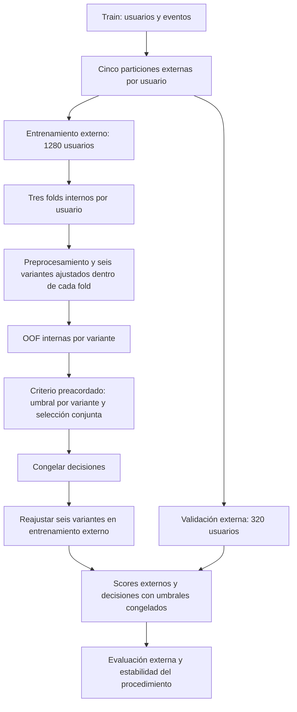

# Propuesta de validación anidada — Fase 4

Fecha: 2026-11-21, America/Bogota. Estado: **diseño para revisión y aprobación; no implementado ni ejecutado**.

## 1. Problema metodológico y alcance

Se propone evaluar un procedimiento que selecciona una variante supervisada y su umbral usando exclusivamente entrenamiento interno. La evaluación externa debe medir el procedimiento completo, incluido el reajuste del estimador y la transferencia del umbral. No debe reutilizarse para optimizarlo.

Hechos históricos, no resultados nuevos: train contiene 46.305 eventos de 1.600 usuarios, 36 ATO de 34 usuarios. CV1 y CV2 respetaron agrupación por usuario. KNN baseline tiene mayor AP en ambas, pero cero TP a 0,5. A 0,4 produce 4 TP, 9/8 FP y 32 FN; a 0,2 produce 11/8 TP, 134/153 FP y 25/28 FN, respectivamente. Estos resultados ya explorados no constituyen una estimación independiente de una elección posterior.

La validación anidada separa selección interna y evaluación externa del procedimiento, pero **no garantiza estabilidad con 34 usuarios positivos**. Además, estos usuarios ya influyeron en la exploración de CV1/CV2: la nueva evaluación será una validación interna del protocolo congelado, no una confirmación completamente independiente del proceso histórico de investigación. Cambiar semilla o folds no borra ese conocimiento previo. La finalidad del anidamiento y el riesgo de selección optimista están descritos en la [documentación oficial de nested CV](https://scikit-learn.org/stable/auto_examples/model_selection/plot_nested_cross_validation_iris.html).

Única escritura de esta tarea: este documento. Se consultaron informes y código en lectura; no se abrió, leyó, inspeccionó ni evaluó test. No se cargaron datasets para producir análisis nuevos, no se ejecutaron experimentos o pruebas de modelos, no se instalaron dependencias y no hubo operaciones Git.

## 2. Diseño principal propuesto: cinco folds externos y tres internos

### 2.1. Unidad de partición y ámbito del estimando

La unidad de separación es **User ID**; la unidad primaria de predicción y de métricas continúa siendo el evento. Esto evalúa eventos de usuarios no presentes en el ajuste, bajo el supuesto histórico de que las características de historial anterior están disponibles secuencialmente. No es una evaluación temporal ni garantiza comportamiento ante cambios futuros de distribución.

Construir una tabla de usuarios ordenada por User ID, con `usuario_con_ato=max(Is Account Takeover)`. Proponer `StratifiedKFold(n_splits=5, shuffle=True, random_state=42)` sobre esa tabla y expandir índices a todos los eventos del usuario. Es el protocolo de agrupación de CV2; se conservaría para comparabilidad, no porque sus métricas sean mejores. Las etiquetas externas pueden usarse para formar estratos según esta regla prefijada, pero no para ajustar, elegir variantes o elegir umbrales.

Los folds externos tendrían 320 usuarios y 6 o 7 usuarios positivos por validación; cada entrenamiento externo tendría 1.280 usuarios y 27 o 28 positivos. Con el mismo orden y datos, la distribución histórica de CV2 es 6/7/7/7/7 usuarios positivos y 6/7/7/8/8 eventos ATO. Estas son referencias históricas que la implementación futura deberá verificar, no particiones reconstruidas en esta tarea.

Dentro de cada entrenamiento externo, reconstruir **su propia** tabla de usuarios y aplicar tres folds estratificados por presencia de ATO, semilla fija 42. No reutilizar índices relativos de otra población. No es necesario cambiar semilla entre niveles para impedir fuga: lo determinante es restringir la población interna al entrenamiento externo. Usar las mismas particiones para las seis variantes y documentar orden de filas, semillas y versiones.

### 2.2. Seis variantes y características inalteradas

| Variante | Configuración que se conserva | Particularidad del ajuste |
| --- | --- | --- |
| Árbol baseline | DecisionTreeClassifier, random_state=42 y parámetros históricos restantes | Sin ponderación |
| Árbol ponderado | Mismo árbol, class_weight='balanced' | Pesos calculados sobre cada conjunto de ajuste |
| GaussianNB baseline | var_smoothing=1e-9 | Sin ponderación |
| GaussianNB ponderado | Misma configuración | sample_weight calculado exclusivamente con el conjunto de ajuste |
| KNN baseline | k=5, weights='uniform', algorithm='brute', metric='euclidean', n_jobs=2 | Sin sobremuestreo |
| KNN + ROS | Mismo KNN | RandomOverSampler, random_state=42, sampling_strategy=1.0 |

Se conserva íntegramente la configuración registrada en `fase04_modelado/modelos.py` y los manifiestos históricos, incluidos parámetros por defecto efectivos. No se añade optimización de hiperparámetros ni selección de variables.

Predictores: Device Type, Country, failed_attempts_15min, failed_attempts_1h, time_since_previous_login_hours y has_previous_login. IDs y target quedan fuera de X. Se mantienen las exclusiones Impossible Travel y el preprocesamiento específico de cada familia.

### 2.3. Ajuste y selección interna

Para cada variante y fold interno:

1. Crear un preprocesador nuevo. Ajustar medianas y categorías One-Hot solo en entrenamiento interno. Aplicar log1p y StandardScaler cuando corresponda; sus estadísticas aprendidas se restringen al mismo conjunto. No reutilizar matrices o transformadores ajustados con todo train ni con todo el entrenamiento externo.
2. Transformar entrenamiento y validación internos. La validación conserva prevalencia y número de eventos originales.
3. Calcular ponderación con y del entrenamiento interno. Para KNN + ROS, sobremuestrear únicamente su matriz de entrenamiento ya transformada; nunca antes de separar usuarios ni sobre validación.
4. Ajustar el estimador y guardar scores de la validación interna. Mantener cada clave y evento_id; cada evento del entrenamiento externo debe tener una OOF interna por variante.
5. Concatenar OOF internas de la misma variante. Buscar el umbral con un criterio **acordado y congelado previamente**. Propuesta de agregación: calcular el criterio con los conteos OOF internos agrupados por evento. Esto conserva la unidad de análisis histórica; dar también valores por fold y por usuario. No alternar entre media de folds y métrica agrupada según cuál favorezca a un candidato.

Rejilla propuesta para cada variante: todos sus scores únicos internos, 0,5 como referencia y extremos «todos»/«ninguno». La regla será explícitamente `score >= umbral`, incluidos empates. Si hay intervalos equivalentes, elegir su extremo superior observado para una representación reproducible. El extremo sin alertas se representa como política explícita, no redondeando un umbral mayor que 1 a 1. Se incluyen todos los estados de decisión, sin seleccionar una rejilla favorable a KNN ni asumir scores continuos.

Esta búsqueda utiliza scores de estimadores distintos dentro del entrenamiento externo; eso introduce una hipótesis de comparabilidad de escalas, analizada en la sección 4. No constituye fuga del fold externo.

Para cada variante conservar su mejor umbral interno y todas las alternativas. Seleccionar además una variante entre las seis usando **el mismo criterio interno**, no AP externa ni resultados históricos. Si se usa una restricción y ninguna pareja la cumple, declarar «sin candidato factible»; no relajarla automáticamente. Debe acordarse antes una regla de salida para poder producir decisiones externas, o informar esa rama como no factible sin fingir cobertura completa de un selector.

Desempate propuesto, pendiente de acuerdo: ante igualdad del criterio, preferir el umbral más próximo a 0,5 dentro de la variante, luego el mayor si persiste el empate. Entre variantes, usar un orden fijo documentado, por ejemplo el orden histórico de la tabla. Es un desempate administrativo, no evidencia de superioridad; registrar todos los empates. No introducir secundariamente una preferencia FP/FN no acordada.

### 2.4. Reajuste y predicciones externas

Una vez congelados los seis umbrales y la variante elegida dentro del entrenamiento externo:

- Reajustar **cada una de las seis variantes** desde cero en todo el entrenamiento externo, con preprocesador nuevo, ponderación local y ROS local cuando corresponda.
- Aplicar su umbral interno a sus scores externos. Guardar también decisiones a 0,5 como referencia; no requiere otro entrenamiento.
- Para el selector conjunto, reutilizar las predicciones externas de la variante elegida internamente. No entrenar otro modelo idéntico ni elegir a posteriori qué variante usar en ese fold.
- Generar predicciones sin proporcionar y externa a componentes de ajuste o selección. La evaluación consulta y externa solo cuando las configuraciones están congeladas.
- Preferiblemente completar y congelar todas las decisiones de los cinco folds antes de revelar el resumen externo. No cambiar el protocolo tras ver un fold desfavorable.

Se obtendrían seis conjuntos completos de predicciones externas —uno por variante con umbral aprendido—, seis referencias a 0,5 y un conjunto del **selector conjunto**. En cada conjunto debe haber una predicción por cada uno de los 46.305 eventos. Son salidas relacionadas, no muestras independientes.

El umbral y la variante del selector pueden cambiar entre folds. Esa es una propiedad del procedimiento que debe informarse. La estimación externa del selector no es la estimación de un único KNN o de un umbral universal.

## 3. Diagrama y pseudocódigo conceptual



```text
ANTES: aprobar objetivo, folds, criterio, desempates y tratamiento de inviabilidad
PARA cada partición externa (A = entrenamiento, B = validación):
    construir particiones internas usando únicamente usuarios de A
    PARA cada una de las seis variantes m:
        producir scores OOF de A con tres ajustes internos independientes
        elegir t[m] con el criterio acordado sobre esas OOF
        guardar métricas internas y diagnóstico de estabilidad (no rendimiento final)
    elegir m* internamente y congelar (m*, todos los t[m])
    PARA cada variante m:
        reajustar preprocesador y m usando únicamente A
        obtener scores de B sin usar y[B]
        guardar decisiones a t[m] y a 0,5
    salida del selector en B = decisiones de m* a t[m*]
DESPUÉS de congelar las cinco particiones:
    verificar cobertura y separación; evaluar usando etiquetas externas
    publicar las seis variantes, referencias, selector y todos los fallos
NO ajustar de nuevo el criterio con los resultados externos
NO acceder al conjunto test reservado
```

## 4. Selección y transferencia del umbral

### 4.1. Respuesta directa

**Sí es metodológicamente admisible** seleccionar un umbral con OOF internas y aplicarlo al modelo reajustado, si ambos pasos forman parte del procedimiento predefinido y el fold externo no interviene. **No garantiza** que ese número conserve la misma precision, recall, tasa de alertas o interpretación probabilística. La evaluación externa debe medir precisamente esa transferencia. La API oficial contempla ajuste de umbral por CV y reajuste posterior, pero ello no equivale a garantizar estabilidad de scores. [Referencia de TunedThresholdClassifierCV, versión 1.7](https://scikit-learn.org/1.7/modules/generated/sklearn.model_selection.TunedThresholdClassifierCV.html).

Con tres folds internos, cada estimador interno ve aproximadamente dos tercios del entrenamiento externo; el reajustado ve todo. Cambian vecinos, hojas, varianzas, pesos de clase, categorías observadas y escalado. Árbol ponderado y ROS pueden cambiar particularmente la relación entre score y prevalencia natural. En KNN el score sigue siendo una fracción de cinco vecinos, pero los vecinos cambian: discreción estable no implica rendimiento estable. Los GaussianNB históricos saturados en 0/1 tampoco garantizan idéntica saturación en nuevos ajustes.

### 4.2. Alternativas

| Estrategia | Qué conserva | Ventaja | Limitación en este proyecto | Decisión propuesta |
| --- | --- | --- | --- | --- |
| OOF internas + reajuste completo | Regla numérica y procedimiento de selección | Aprovecha todo entrenamiento externo; mantiene seis variantes | Transferencia de escala imperfecta; ruido en umbral | Diseño principal, con límites explícitos |
| Modelo fijo + subconjunto interno exclusivo para umbral; sin reajuste posterior | Exactamente el mismo estimador entre elección de umbral y predicción externa | Elimina el cambio de estimador que causa transferencia | Menos usuarios para aprender y pocos ATO para elegir t; dependencia de una sola separación | Alternativa si se exige identidad del estimador |
| Calibración sigmoidal completamente interna | Intenta aproximar una escala probabilística | Puede mejorar comparabilidad si el ajuste es adecuado | Muy pocos positivos; añade parámetros y particiones; no garantiza calibración | No incluir automáticamente en protocolo principal |
| Calibración isotónica interna | Transformación monótona flexible | Puede corregir relaciones no sigmoidales | Alta flexibilidad con muy escasa información positiva; empates y sobreajuste | No recomendable como punto de partida |
| Ensemble de modelos internos con umbral sobre promedio | Mantiene modelos componentes si se congelan | Reduce algunas fluctuaciones de ajuste | La OOF usual usa un modelo por evento y la predicción del ensemble usa varios: distribución distinta | No es una solución gratuita; requiere evaluación específica |
| Percentil/cuota de alertas | Define una regla de volumen en una población de referencia | Evita interpretar score como probabilidad | Cambia la pregunta; necesita cuota acordada y referencia de scores; no conserva recall | No proponer sin requisito previo |
| Umbral 0,5 fijo | Elimina selección de umbral | Referencia sencilla con menos grados de libertad | No corrige desbalance ni mala calibración; puede producir cero TP | Mantener para todas las variantes |

**Modelo fijo sin reajuste:** dentro de A, separar usuarios estratificados en ajuste y selección de umbral, por ejemplo dos tercios/un tercio como diseño ilustrativo. Entrenar las seis variantes solo en ajuste; elegir variante y t en la porción reservada; evaluar ese mismo modelo en B. Aunque se optimizan modelo y umbral en una sola porción, B permanece fuera y evalúa esa selección. No presentar la métrica de esa porción como independiente. Reajustar después usando también los usuarios de selección reintroduciría el problema que esta alternativa evita. No es globalmente mejor: sacrifica datos y aumenta sensibilidad a la partición.

**Calibración:** si se autorizara, cada entrenamiento interno contendría sus propias particiones agrupadas de calibración. El preprocesamiento, pesos y ROS se ajustarían en la porción que aprende el modelo base. El calibrador recibiría scores de usuarios no usados por ese modelo y etiquetas con prevalencia natural, sin ROS ni balanceo que cambie el objetivo probabilístico. La validación interna utilizada para elegir umbral no debe haber servido para ajustar el calibrador que la predice. Tras selección, repetir el procedimiento de calibración dentro de A y evaluar en B.

Un calibrador entrenado sobre scores OOF y aplicado a un modelo base reajustado sigue teniendo una cuestión de transferencia. Mantener parejas modelo-calibrador en un ensemble evita reajustar cada pareja, pero al seleccionar umbrales debe evaluarse la salida de ese procedimiento de ensemble, no mezclarla sin justificación con scores de modelos individuales. La documentación distingue calibración por parejas y calibración con reajuste, y advierte sobre clases ausentes y supuestos de los calibradores. [Calibración en scikit-learn 1.7](https://scikit-learn.org/1.7/modules/calibration.html).

La cifra de miles de eventos negativos no compensa disponer de pocos usuarios positivos para calibración. No se justifica isotónica simplemente porque haya más de mil filas. Tampoco un calibrador monótono puede recuperar ordenamiento fino que no existe cuando los scores almacenados solo toman 0 y 1. Estas son valoraciones para este proyecto, no resultados de una calibración ejecutada.

**Cuotas y ensembles:** calcular un percentil sobre el fold externo completo para fijar alertas sería un protocolo transductivo diferente, no el umbral fijado antes de evaluarlo; no se propone. Promediar umbrales de distintos modelos internos tampoco preserva una decisión común. Cualquier alternativa debe congelarse antes de evaluar y contarse como procedimiento nuevo; no se añadirá silenciosamente como modificación de las seis variantes.

### 4.3. Control de transferencia sin corregir mirando el exterior

Registrar por fold la distribución de scores internos, umbral seleccionado, intervalo de decisiones equivalentes y dispersión de métricas internas. Tras congelar predicciones externas, describir scores y tasas de alertas externas, cumplimiento o incumplimiento de restricciones y cambios de rendimiento. Un desplazamiento externo se informa, no se usa para corregir t. No recalibrar ni ajustar cuotas sobre B. No comparar scores de entrenamiento del modelo reajustado como si fueran predicciones fuera de muestra.

## 5. Criterio de selección: decisión pendiente

No hay criterio universalmente neutro. Elegir una métrica introduce una preferencia académica incluso sin costes monetarios. Debe acordarse **antes** de la nueva ejecución y aplicarse por igual a las seis variantes. La documentación distingue aprender scores de elegir la acción mediante un umbral. [Guía de umbrales, versión 1.7](https://scikit-learn.org/1.7/modules/classification_threshold.html).

| Criterio | Interpretación | Ventajas | Qué exige o limita |
| --- | --- | --- | --- |
| Maximizar F1 | Media armónica de precision y recall de ATO; ignora TN | Reproducible sin inventar precios; referencia académica habitual | No es neutral ni necesariamente acorde con prioridad de recall; sensible a prevalencia y pocos TP |
| Maximizar F-beta | F-beta=(1+beta²)PR/(beta²P+R) | Permite explicitar preferencia | beta>1 enfatiza recall; beta<1 precision. beta=2 no significa que FN cueste cuatro veces FP; beta requiere acuerdo |
| Maximizar recall sujeto a FP o FPR máximo | Detectar lo máximo dentro de una restricción | Hace explícita tolerancia a falsas alarmas | Definir límite, unidad, denominador, periodo y si se exige en promedio o por fold; puede ser inviable |
| Recall con presupuesto de alertas | Limita TP+FP, no únicamente FP | Relacionado con carga de revisión | Requiere capacidad por evento/usuario/periodo y política de repetición de alertas |
| Maximizar recall con precision mínima | Controlar proporción de alertas correctas | Fácil de expresar | Muy inestable con pocas alertas y dependiente de prevalencia; una precision perfecta con un TP no es prueba sólida |
| Minimizar FP sujeto a recall mínimo | Prioriza cobertura fijada | Expone los FN tolerados | Requiere un mínimo justificado; cumplirlo internamente no garantiza cumplimiento externo |
| t=0,5 fijo | Sin optimización de umbral | Referencia comparable y auditable | No implica probabilidades calibradas ni decisión adecuada |

Para restricciones operativas faltan: unidad de decisión (evento o usuario), periodo, capacidad de revisión, tratamiento de alertas repetidas, objetivo mínimo de detección, tasa aceptable de omisiones, prevalencia y escenario de uso al que se refiere la restricción. FP absoluto de un fold no se transfiere directamente a otro de tamaño distinto; distinguir FPR=FP/negativos, FP por mil eventos y porcentaje de alertas. No inventar que son equivalentes.

**Propuesta para aprobación:** si el profesor necesita un único objetivo académico sin restricciones operativas, considerar F1 agrupado de las OOF internas como criterio principal explícitamente convencional, junto con la referencia 0,5 y presentación obligatoria de recall/FP/FN. No se adopta aquí ni se escoge porque favorezca a KNN. Si se acuerda prioridad de recall mediante beta o una restricción, sustituir el criterio principal antes de ejecutar. No probar varias métricas y después elegir como principal la que produzca el mejor resultado externo.

Se pueden registrar escenarios secundarios prefijados con las mismas OOF internas, sin entrenar otra vez, pero sus resultados deben presentarse como análisis múltiples. Elegir el escenario ganador usando el exterior agrega otra capa de selección y pierde la interpretación de evaluación del protocolo prefijado. AP describe ranking; no selecciona el umbral porque no cambia al moverlo.

## 6. Viabilidad con 34 usuarios positivos

Las cantidades siguientes son consecuencias aritméticas de estratificar usuarios, no resultados de nuevas particiones. Eventos ATO y totales por fold no quedan igualados automáticamente.

| Diseño externo × interno | Usuarios positivos en validación externa | En entrenamiento externo | En validación interna | Ajustes base para seis variantes y comparación completa |
| --- | --- | --- | --- | --- |
| 5 × 5 | 6–7 | 27–28 | 5–6 | 180 |
| **5 × 3** | **6–7** | **27–28** | **9–10** | **120** |
| 4 × 3 | 8–9 | 25–26 | 8–9 | 96 |
| 3 × 3 | 11–12 | 22–23 | 7–8 | 72 |

En 5×3, cada entrenamiento interno conserva aproximadamente 18–19 usuarios positivos y 853–854 usuarios totales; cada validación interna unos 426–427 usuarios. Cinco folds internos entrenarían con más positivos por ajuste, pero evaluarían el umbral en porciones de 5–6 usuarios positivos. El pooling interno usa finalmente todos los 27–28 positivos externos disponibles, pero procede de modelos distintos: ni tres ni cinco folds elimina esa limitación.

Cinco folds externos mantienen entrenamiento externo de 80% de usuarios y comparabilidad con CV2. Tres internos reducen fragmentación y coste; se acepta que sus estimadores se ajustan con dos tercios de A y pueden transferir peor a un reajuste completo que con cinco internos. Cuatro externos pueden ser una alternativa si se prioriza un poco más de soporte positivo externo, pero cambian tamaño de entrenamiento y protocolo; no deben elegirse tras comparar resultados.

Con solo 6–8 ATO por validación externa histórica, un acierto modifica recall de fold aproximadamente 12,5–16,7 puntos porcentuales; globalmente un evento cambia recall 2,78 puntos. Estratificar evita folds sin usuarios positivos en estos tamaños, pero no asegura TP, precisión definida o cumplimiento de restricciones. Usuarios con dos ATO pueden tener más peso; el conteo efectivo de evidencia positiva no es 36 observaciones independientes.

Los cinco folds no son réplicas independientes: sus entrenamientos se solapan. No interpretar DE como intervalo de confianza ni hacer un test t ingenuo con cinco valores. Repetir semillas prefijadas puede describir sensibilidad, pero no crear información nueva; una repetición principal es suficiente para el primer diseño. Repeticiones adicionales requerirían autorización y reporte conjunto sin escoger la más favorable.

**Fiabilidad esperada:** suficiente para auditar ausencia de fuga y describir cómo se comporta el procedimiento; insuficiente para prometer una clasificación estable entre modelos o un umbral universal. Si la selección cambia mucho, hay empates o se incumplen restricciones externas, el dictamen correcto es «evidencia insuficiente».

Alternativa más conservadora para afirmaciones fuertes: mantener las seis variantes y umbrales de referencia prefijados como comparación descriptiva, no forzar ganador, y obtener más usuarios positivos independientes antes de una selección concluyente. Un holdout adicional sacado del train ya explorado no se vuelve independiente retrospectivamente y reduce aún más el soporte positivo. El modelo fijo con reserva interna resuelve identidad del estimador, pero tampoco resuelve la escasez estadística. Test permanece reservado y no se usa para resolver estas decisiones.

## 7. Métricas externas, comparación y cierre futuro

Publicar para cada variante con umbral aprendido y a 0,5: TP, FP, TN, FN, precision, recall, F1, AP por fold, número/porcentaje de alertas, tiempos, usuarios ATO detectados y usuarios con FP. Mostrar resultados por fold, totales OOF externos y media/DE; distinguir métrica agregada y promedio no ponderado. Informar precision=0 por convención junto a la bandera sin predicciones positivas cuando corresponda. Mantener todos los resultados desfavorables.

Para el selector conjunto, publicar además variantes y umbrales elegidos por fold, empates, frecuencia de selección y fallos de factibilidad. Comparar decisiones externas con la referencia a 0,5 mediante conteos pareados por evento/usuario, sin fingir independencia entre variantes.

La AP por fold usa scores de un estimador evaluado en su validación. La AP global de una variante concatena cinco estimadores: declarar la limitación de comparabilidad. Para el selector conjunto, que puede alternar familias, **no usar AP global de scores heterogéneos como indicador principal ni ranking común**; presentar AP de cada fold y su resumen identificado, y métricas de decisiones externas agregadas. No concatenar scores de modelos distintos como si fueran probabilidades calibradas comunes.

Si después se escoge el modelo con mejor resultado externo entre seis, esa comparación añade selección: no presentar la métrica del ganador como estimación libre de ese optimismo. La salida externa del selector interno sí evalúa la regla conjunta prefijada, condicionada a los límites de diseño y exploración histórica.

Un entrenamiento final futuro exigiría volver a ejecutar la regla de selección aprobada dentro de todo train y reajustar la variante resultante; no elegir el mejor fold, promediar sus umbrales ni fijar automáticamente el umbral más frecuente. El salto de tamaño al ajuste final también puede alterar scores. La aprobación de este diseño no autoriza ese entrenamiento ni la evaluación de test.

KMeans y Ward permanecen en sus informes históricos como análisis no supervisados separados. No participan en la selección de umbral, no se convierten en clases de ataque y no se comparan silhouette/DB/CH con precision/recall/AP. La entrega académica seguirá mostrando los cinco algoritmos y todas las variantes supervisadas.

## 8. Coste computacional estimado

Sin búsqueda de hiperparámetros, seis variantes, K externos y J internos:

`ajustes internos = 6 × K × J`

`reajustes externos = 6 × K`

`total = 6 × K × (J + 1)`

Para 5×3: **90 ajustes internos + 30 reajustes externos = 120**. Incluye ajuste del preprocesamiento y ROS/ponderación correspondiente en cada ejecución. Predicciones a distintos umbrales, referencia 0,5 y salida del selector reutilizan scores: no añaden entrenamientos. Guardar scores, ordenarlos y acumular conteos evita recomputar métricas mediante nuevos ajustes.

Si solo se evaluara el selector conjunto, bastarían 90 + 5 = 95 ajustes, pero **no se propone esa reducción**, porque se deben conservar resultados externos de las seis variantes. Para 5×5 serían 180; para tres repeticiones completas 5×3, 360. Son escenarios, no ejecuciones autorizadas.

Una calibración interna de tres particiones mediante ensemble de parejas modelo-calibrador, aplicada en cada ajuste del diseño principal, supondría aproximadamente 120×3=360 ajustes base y 360 calibradores, sin explorar métodos adicionales. Si se utiliza calibración OOF con un reajuste base adicional por objeto calibrado, serían aproximadamente 120×(3+1)=480 ajustes base y 120 calibradores. En ambos casos se necesita mantener agrupación por usuario en todos los niveles y verificar soporte de clases. La configuración concreta podría cambiar el coste; no son mediciones.

La calibración más profunda dejaría alrededor de 6–7 usuarios positivos por partición de calibración dentro de algunos entrenamientos internos, lo que refuerza la cautela. La memoria aumenta si se conservan varios modelos, especialmente KNN+ROS. Proponer ejecución secuencial por variante/fold, dos hilos como la referencia histórica y persistencia de scores y auditoría en lugar de mantener todos los estimadores en memoria.

Los manifiestos históricos registran aproximadamente 19,76 y 21,84 segundos para 30 ajustes completos de sus CV, con RSS observado cercano a 263–264 MiB. Una extrapolación puramente lineal de cuatro veces ese trabajo sería unos 79–87 segundos para 120 ajustes. **No es una predicción fiable del tiempo de pared:** cambian tamaños internos, costes de predicción, ROS, escritura y métricas; tampoco garantiza el mismo pico de memoria. No se ha ejecutado benchmark en esta tarea. Presupuestar margen para minutos de procesamiento y comprobaciones, y medir en una futura ejecución autorizada.

Después de aprobar selección final, una CV interna de tres folds sobre todo train para las seis variantes y un solo reajuste final añadiría 18+1=19 ajustes. No forma parte de esta propuesta de ejecución externa ni queda autorizado por este documento.

## 9. Riesgos y controles a exigir antes de implementar

| Riesgo | Control previsto |
| --- | --- |
| Usuario repartido entre niveles | Índices de usuarios explícitos; intersección vacía ajuste/validación en cada nivel |
| Preprocesamiento aprendido fuera del ajuste | Factorías nuevas, registros de filas, medianas, categorías y escalado por ajuste |
| ROS o pesos calculados globalmente | Aplicación local después de transformar; validaciones con prevalencia original |
| Acceso inadvertido a test | Lista permitida de entradas y guardia de apertura; no abrirlo siquiera para hash o inspección |
| OOF históricas reutilizadas como internas | Generar OOF internas nuevas restringidas a A; las antiguas solo se citan como antecedentes |
| Variantes/protocolos mezclados | Clave compuesta evento, fold externo, fold interno, variante, regla y repetición |
| Ajuste al observar exterior | Congelar criterio y decisiones antes de reportar métricas externas |
| Empates y redondeo | Regla >= explícita, precisión de scores y desempates prefijados |
| Selección sin solución factible | Estado y salida de fallo aprobados previamente; no cambiar límites silenciosamente |
| Transferencia inestable | Evaluar procedimiento completo; describir cambios sin reajustar con validación |
| Ganador externo elegido retrospectivamente | Separar análisis de seis variantes y evaluación del selector interno |
| Optimismo por investigación previa | Reconocer exploración CV1/CV2; no presentar nueva CV como datos nunca vistos |

Pruebas propuestas, **no implementadas ni ejecutadas aquí**: exclusión de target/IDs de X; cobertura OOF interna y externa; clases y grupos válidos; reproducibilidad de índices; estadísticas del preprocesador calculadas solo con filas autorizadas; ROS exclusivamente en ajuste; métricas con empates y sin alertas; equivalencia entre decisiones guardadas y score/umbral; selección invariante ante cambios de y externa una vez fijados los splits; bloqueo de test; conservación de hashes de fuentes permitidas y rechazo de sobrescrituras. La prueba de invariancia no debe reconstruir los estratos externos tras alterar y: se verifica la frontera de selección con splits ya congelados.

No usar automáticamente los defaults de un wrapper: `TunedThresholdClassifierCV` tiene criterios y particiones por defecto que no representan este diseño, y su agregación no debe suponerse idéntica al pooling propuesto. Una futura implementación debe proporcionar índices por usuario y verificar fórmula, candidatos, empates y reajuste. La propuesta no obliga a utilizar ese wrapper ni requiere paquetes nuevos.

## 10. Recomendación y decisiones pendientes de aprobación

**Recomendación:** adoptar como diseño inicial 5 externos × 3 internos, estratificados por usuario ATO, seis variantes históricas y OOF internas más reajuste completo, con referencia 0,5 para todas. No añadir calibración por defecto. Evaluar simultáneamente los seis procedimientos de ajuste de umbral y el selector conjunto; publicar todo sin declarar ganador de antemano.

La justificación es transparencia y aprovechamiento de datos, no certeza de transferencia. Si se exige aplicar el umbral al mismo estimador exacto con el que se seleccionó, considerar la alternativa de ajuste/reserva interna sin reajuste, aceptando pérdida de información y alta varianza. Ninguna alternativa permite prometer robustez con 34 usuarios positivos. Si los resultados no distinguen procedimientos de manera defendible, conservar finalistas o declarar insuficiencia y priorizar más datos independientes.

Antes de implementar deben acordarse:

1. Aprobar 5×3, una ejecución principal, semillas y agrupación especificadas, o justificar otra configuración antes de ver resultados.
2. Fijar el objetivo principal de selección: F1 como convención académica, F-beta con beta acordado o restricción justificada. No existe criterio definitivo en este documento.
3. Confirmar unidad primaria por evento, agregación interna agrupada y métricas complementarias por usuario.
4. Aprobar desempates, referencias y comportamiento cuando no hay predicciones positivas o no existe solución factible.
5. Aceptar la transferencia OOF→reajuste como parte del procedimiento evaluado, o elegir explícitamente la alternativa de modelo fijo. La calibración requeriría diseño y autorización adicionales.
6. Confirmar que no se elegirá un criterio, escenario o protocolo nuevo tras observar los folds externos; cualquier cambio abre una etapa exploratoria distinta.
7. Autorizar creación futura de código, pruebas, resultados y gráficas en una carpeta nueva, sin sobrescribir CV1/CV2 ni artefactos previos; definir presupuesto de recursos y si se permiten repeticiones.
8. Mantener autorización separada para selección/entrenamiento final y, posteriormente, para cualquier acceso a test.

**Conclusión:** la validación anidada es defendible para evaluar el procedimiento de selección sin incorporar etiquetas externas a sus ajustes. No es suficiente por sí sola para garantizar un umbral estable o superioridad definitiva. No se declara modelo ganador, no se fija umbral final y no se declara terminada Fase 4.

## 11. Fuentes consultadas

- [Informe de selección y umbrales](INFORME_SELECCION_SUPERVISADA_FASE04.md): hechos históricos y límites del análisis exploratorio.
- [Partición de usuarios de CV2](fase04_modelado/folds_usuario.py), [variantes históricas](fase04_modelado/modelos.py) y [transformaciones](fase04_preparacion/transformaciones.py): contratos de código consultados en lectura.
- [Manifiesto CV1](fase04_modelado/resultados/configuracion_auditoria.json) y [manifiesto CV2](fase04_modelado/resultados_cv_usuario/configuracion_auditoria.json): tiempos, recursos y versiones históricas, sin nueva ejecución.
- Documentación oficial enlazada en el texto: nested CV y, para decisiones de API, páginas de scikit-learn 1.7, acordes con la versión 1.7.2 registrada en el proyecto. Consulta: 2026-11-21. Las propuestas de folds, controles y criterios son recomendaciones de este documento, no resultados experimentales ni garantías de la biblioteca.
